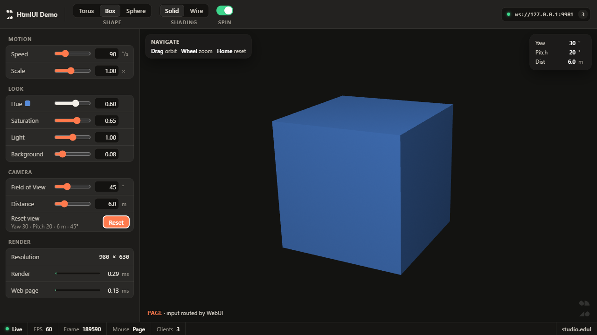

# HtmlUI Demo — TouchDesigner UI in HTML, TD render in the hole



The toolbar, sidebar, status bar and the glass panels are an HTML page (Web Render TOP). The 3D area is a transparent
hole in that page, and TD's own Render TOP is composited right under it. Drag in the hole = orbit the camera (TD),
anything else = the page. The same page also works in a normal browser on the LAN (controls only).

## 1. Just try it (no Claude needed)
1. TouchDesigner 2025.x → drag `HtmlUIDemo.tox` into `/project1`.
2. Select it → parameter page **Demo** → **Open Window**.
3. Optional: open `http://127.0.0.1:9981/` in a browser - the same page, controls only.

## 2. Build it yourself / edit the files
Textport (Alt+T):
```python
BASE = 'C:/path/to/example'; exec(open(BASE + '/build.py', encoding='utf-8').read())
```
Options (set before the `exec`): `SIZE = (1080, 1920); DPI = 2` for a vertical, phone-sized app (the page switches to
its portrait layout), `SLOW = True` builds one operator at a time with the network editor following (for recordings).
Or with Claude Code + TDMCP: *"Use the edul-webui-td skill and build the example in /project1."*

The page and Python files are file-synced: edit `web/*` and close / reopen the window (it reloads the page);
`td/*.py` changes apply on the next frame. Close the window before running `build.py` again.

## Files
| File | What |
|---|---|
| `build.py` | Builds `/project1/HtmlUIDemo` step by step: scene, code DATs, server, webui container, window |
| `td/logic.py` | Protocol (`sub` / `set` / `pulse` / `embed` / `vals` / `stats`), compositing sizes, mouse & key routing, orbit |
| `td/server_cb.py` | Web Server DAT callbacks: serves the page, passes WebSocket JSON to `logic` |
| `web/` | The page. Controls bind by markup (`data-par`, `data-pulse`, `data-stat`) - adding one is mostly HTML |
| `tests/test_routing.py`, `test_read.py` | Fake mouse / key input inside TD at any size (asks the page where its controls are) |
| `tdui/build_tdui.py` | The same UI built from TD panel COMPs, driving the same parameters (for comparison) |
| `tdui/build_tdwidgets.py` | The same layout from TD's stock widgets (Palette > Basic Widgets), default look, Value0 bound to the same parameters |
| `export_tox.py` | Saves `HtmlUIDemo.tox` with the files embedded |

## Make it yours
- Replace `geo1` / `cam1` / `render1` with your scene and point `webui/viewport_render` at your Render TOP.
- New control: add a custom parameter on `HtmlUIDemo`, add it to `EXPOSED` in `td/logic.py`, add markup in
  `web/index.html` (`<input type=range data-par="Name">`, `<button class="sw" data-par="Name">`, ...).
- A panel floating over the 3D area needs `class="glass"` inside `#viewport`, so clicks on it stay on the page.

## Limits
- Non-Commercial licence: TOPs max 1280 x 1280 (use the default 1280 x 720, not the vertical build).
- Port 9981 must be free (change the `Port` parameter otherwise).
- Remote browsers can change values but not the TD window's layout (that needs the `Embedkey`).

Tested in TouchDesigner 2025.33070: fake-input test 9 / 9 (slider, switch, segment, orbit, glass panel, wheel, Reset
button, key-less embed refused) at 1280 x 720 and 1080 x 1920 / dpiscale 2.
